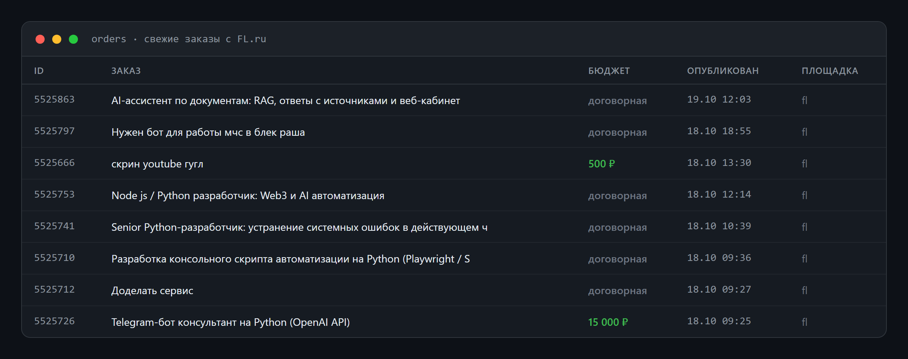
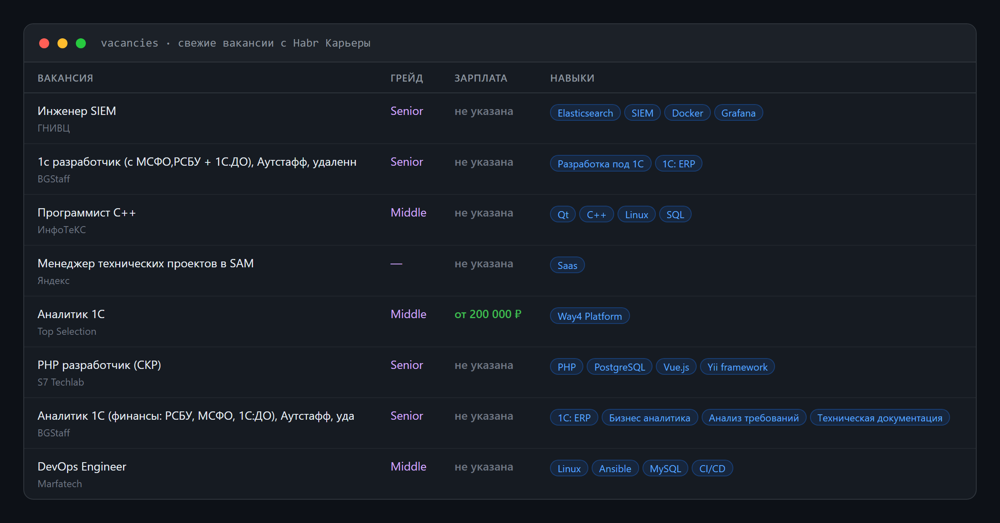
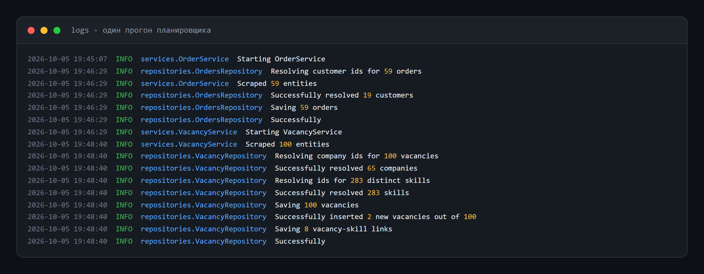
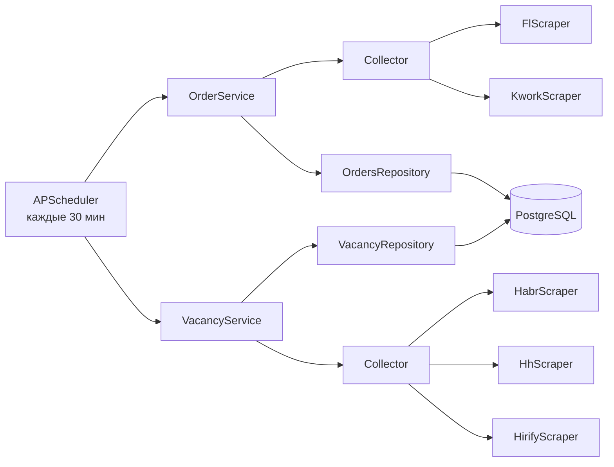
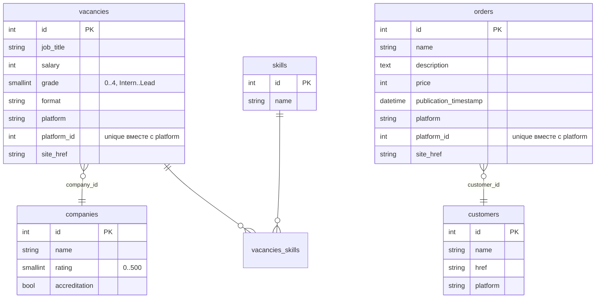

<div align="center">

# 🔎 Find Job Parser

**Сервис, который сам собирает свежие IT-заказы и вакансии с пяти площадок и складывает их в одну базу.**

Вместо того чтобы каждый час открывать FL, Kwork, hh.ru и Habr Карьеру, достаточно один раз запустить контейнер.
Каждые 30 минут парсер обходит площадки, берет только новое и сохраняет в PostgreSQL в аккуратном, нормализованном виде.


</div>

---

## Как это выглядит

**Заказы с FL.ru**, которые парсер забрал из RSS-ленты раздела «Программирование»:



**Вакансии с Habr Карьеры** с грейдом, зарплатой, компанией и стеком технологий:



**Один прогон планировщика в логах.** Видно, как сервис собирает данные, находит или создает компании, заказчиков и навыки, а потом сохраняет только новые записи:



> Скриншоты сделаны на реальных данных: таблицы собраны живым запуском парсеров, логи взяты из рабочего прогона.

---

## Что умеет

- **5 площадок в одном месте.** Заказы фрилансеров и вакансии работодателей собираются двумя независимыми конвейерами.
- **Без дублей.** Перед загрузкой подробностей парсер сверяет ID с базой и открывает только новые карточки, поэтому повторные прогоны не нагружают ни площадки, ни базу.
- **Аккуратно с сайтами.** Где у площадки есть машиночитаемый источник (RSS, sitemap), парсер берет данные оттуда, а браузер поднимает только там, где без него не обойтись.
- **Нормализованная база.** Компании, заказчики и навыки лежат в отдельных таблицах, а вакансии связаны с навыками через таблицу many-to-many. По базе удобно строить аналитику, например «какие навыки чаще всего просят у Middle Python».
- **Устойчивость.** Если одна площадка упала или поменяла верстку, остальные продолжают работать. Ошибка попадает в лог, а прогон не останавливается.
- **Логи с ротацией.** У каждого модуля свой файл, по 5 МБ, хранится 5 последних.
- **Работает сам.** Docker-контейнер с `restart: unless-stopped` и встроенным планировщиком APScheduler.

## Площадки

| Площадка | Что собирает | Как |
|---|---|---|
| [FL.ru](https://www.fl.ru/projects/) | Заказы | RSS + httpx + BeautifulSoup |
| [Kwork](https://kwork.ru/projects) | Заказы | Playwright |
| [hh.ru](https://hh.ru) | Вакансии | Playwright |
| [Habr Карьера](https://career.habr.com) | Вакансии | RSS + httpx + BeautifulSoup |
| [Hirify](https://hirify.me) | Вакансии | Sitemap + httpx |

## Архитектура

Проект разбит на слои, у каждого одна задача. Чтобы добавить новую площадку, достаточно написать один класс-скрапер и дописать его в список в `main.py`, остальное подхватится само.



| Слой | Папка | За что отвечает |
|---|---|---|
| Scraper | `scrapers/` | Достает данные с одной площадки и отдает DTO |
| Collector | `collectors/` | Опрашивает несколько скраперов и изолирует их ошибки друг от друга |
| Service | `services/` | Ведет конвейер: узнать известные ID, собрать новое, сохранить |
| Repository | `repositories/` | Пишет в базу пачками, находит или создает связанные сущности |
| Models | `db/models/` | Схема БД на SQLAlchemy 2.0 с ограничениями и уникальными ключами |

## Схема базы



## Стек

- **Python 3.12**, полностью асинхронный код на `asyncio`
- **Playwright** для сайтов, которые рендерятся через JavaScript
- **httpx + BeautifulSoup** для RSS, sitemap и обычного HTML
- **SQLAlchemy 2.0 (async) + asyncpg** для работы с базой
- **PostgreSQL** как хранилище
- **APScheduler** для запуска по расписанию
- **Docker / Docker Compose** для деплоя
- **python-decouple** для настроек через `.env`

## Запуск

### Через Docker

PostgreSQL живет в отдельном compose-проекте, а парсер подключается к нему через общую сеть `find_job_network`. Благодаря этому базу и ее бэкапы можно обновлять, не трогая приложение.

```bash
git clone https://github.com/LastCoolFish/find_job_parser.git
cd find_job_parser
cp .env.example .env        # укажи логин и пароль от базы
docker compose up -d --build
```

Логи будут появляться в папке `logs/` на хосте.

### Локально

```bash
python -m venv .venv
.venv\Scripts\activate       # Windows, на Linux/macOS: source .venv/bin/activate
pip install -r requirements.txt
playwright install chromium
python main.py
```

Чтобы смотреть, как работает браузер, поставь `HEADLESS=False` в `.env`.

## Настройки

| Переменная | Что это | Пример |
|---|---|---|
| `DB_USER` | Пользователь PostgreSQL | `db_user_name` |
| `DB_PASSWORD` | Пароль | `db_user_password` |
| `HOST` | Хост базы (в Docker подставляется автоматически) | `localhost` |
| `PORT` | Порт базы | `5432` |
| `DB_NAME` | Имя базы | `FindJob` |
| `HEADLESS` | Запускать браузер без окна | `True` |

## Структура проекта

```
find_job_parser/
├── main.py              # точка входа и планировщик
├── collectors/          # сбор с нескольких площадок
├── services/            # конвейеры заказов и вакансий
├── repositories/        # сохранение в базу
├── scrapers/
│   ├── orders/          # FL, Kwork
│   ├── vacancies/       # Habr, hh.ru, Hirify
│   ├── dto/             # объекты передачи данных
│   └── base_scraper.py  # базовые классы для Playwright и httpx
├── db/                  # подключение и модели SQLAlchemy
├── logging_config.py    # логи с ротацией
├── Dockerfile
└── docker-compose.yml
```

---

<div align="center">

Нужен похожий парсер, бот или автоматизация под вашу задачу? Пишите, обсудим.

</div>
